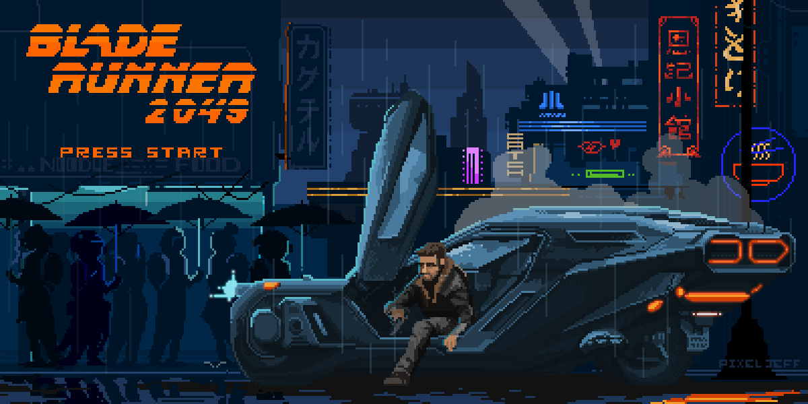
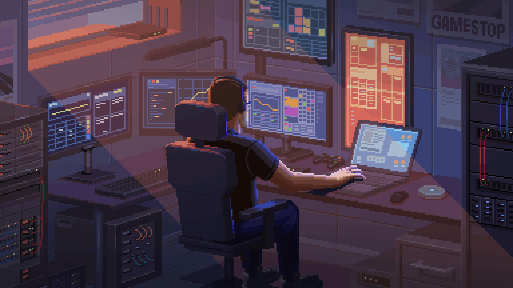

<p align="center">
  
</p>

<p align="center">
  
</p>

<!-- Mascot + Introduction Grid -->
<div>
  
</div>

#  ɪ'ᴍ xᴡᴜᴀɴ19
*Cyberdeck Operator • iOS Tweak Engineer & Proxy Architect*

<br />

<!-- Animated Dynamic Typing Header -->
<a href="https://github.com/Xwuan19">
  
</a>

<br /><br />

<!-- Quick Status Pills -->
<p align="left">
  
  <a href="https://github.com/xwuan"></a>
  
  
</p>

---

### ⚡ `Xwuan19@cyberdeck:~$ neofetch --deck`

```yaml
node:
  alias: "Xwuan19"
  role: "Cyberdeck Operator & iOS Tweak Architect"
  class: "Mobile Reverse Engineering & Autonomous Telemetry"
  motto: "Break the walled garden. Route the unroutable."

arsenal:
  ios_tweaks:
    - "Locket-XVIP: Remote Config Siêu VIP (Locket Gold, 4K UHD, 30s Video)"
    - "EeveeSpotifyReborn: High-Fidelity Audio Tweak"
    - "Custom Signed IPAs & Dynamic Mobile Substrates"
  proxy_routing:
    - "Automated Subscriptions (V2Ray / VLESS / Trojan / Shadowsocks)"
    - "Shadowrocket & Quantumult X Policy Rule Engines"
  automation:
    - "Antigravity AI Skills Orchestration (OS Automation)"
    - "Python Daemon Host Control (RemotePC)"

sister_node: "https://github.com/xwuan (Core Sanctuary)"
```

---

<!-- Flagship Showcase Section -->
<h2 align="center">🚀 Fʟᴀɢsʜɪᴘ Dᴇᴘʟᴏʏᴍᴇɴᴛs 🚀</h2>
<p align="center"><i>High-impact iOS tweaks, automated proxy harvesters & autonomous toolkits</i></p>

<table width="100%">
  <tr>
    <td width="50%" align="center" valign="middle">
      <a href="https://github.com/Xwuan19/Locket-XVIP">
        
      </a>
      <p align="left">
        <b>👑 Locket-XVIP:</b> Remote Config Siêu VIP Pro Max mở khóa toàn diện Locket Gold, chuẩn 4K Ultra HD, quay video 30s & mở khóa kết bạn không giới hạn.
      </p>
    </td>
    <td width="50%" align="center" valign="middle">
      <a href="https://github.com/Xwuan19/v2nodes-auto-sub">
        
      </a>
      <p align="left">
        <b>⚡ v2nodes-auto-sub:</b> Hệ thống tự động thu thập, kiểm tra tốc độ và đóng gói subscription V2Ray, Trojan, Shadowsocks chất lượng cao.
      </p>
    </td>
  </tr>
  <tr>
    <td width="50%" align="center" valign="middle">
      <a href="https://github.com/Xwuan19/antigravity-skill-os">
        
      </a>
      <p align="left">
        <b>🤖 antigravity-skill-os:</b> Framework điều phối kỹ năng và thực thi công cụ tự động cho Antigravity AI Agent.
      </p>
    </td>
    <td width="50%" align="center" valign="middle">
      <a href="https://github.com/Xwuan19/Shadowrocket_IPA">
        
      </a>
      <p align="left">
        <b>🛰️ Shadowrocket_IPA:</b> Kho lưu trữ IPA tuyển chọn, cấu hình routing nâng cao & chứng chỉ hoạt động ổn định trên iOS.
      </p>
    </td>
  </tr>
</table>

---

<!-- Tech Stack Matrix -->
<h2 align="center">🛠️ Tᴇᴄʜ Sᴛᴀᴄᴋ & Cʏʙᴇʀ Aʀsᴇɴᴀʟ 🛠️</h2>

<p align="center"><b>📱 iOS Modding & Core Languages</b></p>
<p align="center">
  <a href="https://skillicons.dev">
    
  </a>
</p>

<p align="center"><b>🌐 Proxy Routing, Containers & Network Nodes</b></p>
<p align="center">
  <a href="https://skillicons.dev">
    
  </a>
</p>

<p align="center"><b>⚡ Cyberdeck Workstation & Tooling</b></p>
<p align="center">
  <a href="https://skillicons.dev">
    
  </a>
</p>

<p align="center">
  
  
  
  
  
</p>

---

<!-- Live Analytics & Telemetry Grid -->
<h2 align="center">📊 Tᴇʟᴇᴍᴇᴛʀʏ & Lɪᴠᴇ Sᴛᴀᴛs 📊</h2>

<table width="100%">
  <tr>
    <td width="50%" align="center" valign="middle">
      <a href="https://github.com/Xwuan19">
        
      </a>
    </td>
    <td width="50%" align="center" valign="middle">
      <a href="https://github.com/Xwuan19">
        
      </a>
    </td>
  </tr>
</table>

<div align="center">
  <a href="https://github.com/Xwuan19">
    
  </a>
</div>

<br />

<!-- Contribution Activity Graph -->
<h3 align="center">📈 Cᴏɴᴛʀɪʙᴜᴛɪᴏɴ Aᴄᴛɪᴠɪᴛʏ 📈</h3>
<div align="center">
  
</div>

<br />

<!-- Contribution Snake -->
<h3 align="center">🐍 Cᴏɴᴛʀɪʙᴜᴛɪᴏɴ Sɴᴀᴋᴇ 🐍</h3>
<div align="center">
  <picture>
    <source media="(prefers-color-scheme: dark)" srcset="https://raw.githubusercontent.com/Xwuan19/Xwuan19/output/github-contribution-grid-snake-dark.svg">
    <source media="(prefers-color-scheme: light)" srcset="https://raw.githubusercontent.com/Xwuan19/Xwuan19/output/github-contribution-grid-snake.svg">
    
  </picture>
</div>

---

<!-- Cyberdeck Audio Vibe Dock -->
<div align="center">
  
  <b>&nbsp;Cyber Vibe:</b> <i>Darksynth // Cyberpunk Hacker Radio ⚡</i>
</div>

<br />

<!-- Connect & Sister Deck Dock -->
<h2 align="center">🤝 Nᴇxᴜs Gᴀᴛᴇᴡᴀʏ 🤝</h2>
<div align="center">
  <a href="https://github.com/Xwuan19"></a>
  <a href="https://github.com/xwuan"></a>
  <a href="https://github.com/Xwuan19/Locket-XVIP/issues"></a>
  <a href="https://t.me/"></a>
</div>

<br />

<!-- Waving Footer Banner -->
<p align="center">
  
</p>
